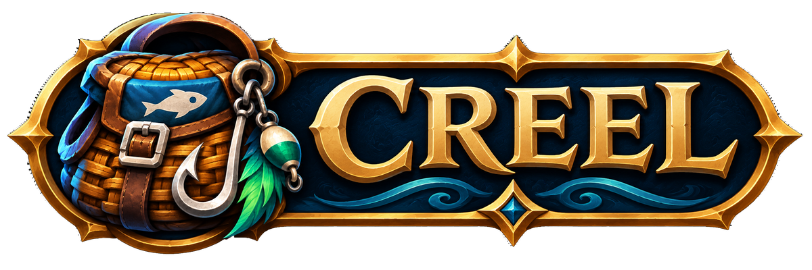

> **Not released yet.** Creel is being tested on the `dev` branch, and
> isn't on CurseForge or Wago yet.

**A fishing log and one-key cast for World of Warcraft: Forever.**

A creel is the wicker basket an angler carries the catch home in. This one
keeps a calm panel on screen while you fish, gives every catch its worth
and a tip worth reading, and keeps a book of everything you've ever caught
and where.

## What it does

- **One key to cast and reel.** Press your key to cast, and press it again
  when the bobber splashes to reel in. Or double right-click to cast, if
  you prefer. A short setup page asks which, and binds nothing until you
  say so.
- **A calm panel.** Your skill, a line timer, time this trip and in all,
  and whether fish get away at this spot at your skill. Each catch drops
  into a card with its quality, what a vendor pays, what it fetches at
  auction, and a tip. Below it, the trip's tally and what it's worth.
- **Unique finds.** Something on the line that Creel doesn't know about
  gets a moment of its own: the grand loot card, a burst of light and the
  game's epic-loot sound. A catch worth a lot plays the auction house's
  sound. Both can be turned off.
- **Quiet while fishing.** One click on the speaker turns off music,
  ambience and chatter so the splash stands out, and gives your own sound
  settings back exactly when you stop.
- **A lure slot.** Shows the lure on your pole and the minutes left. Click
  it to put on the best lure in your bags. It never does it by itself.
- **The Fishing Book.**
  - **Collection:** every fish and catch as an icon gallery, with
    silhouettes for the ones still to find. Click one for where it bites,
    what it's worth and what it turns into.
  - **Recipe cards:** how to make anything a catch turns into, what the
    parts cost, and whether it's worth it, with a link into Goldwise's
    crafting tree if you have Goldwise.
  - **Places:** your spots, with nearby catches grouped into one place,
    and pins on the world map if you want them.
  - **Trips:** every trip, your records, and what each was worth.
  - **Earnings:** what your catches, and what you made from them, have
    sold for.
  - **Next:** where your next rank comes from, the nearest trainer, where
    to fish at your skill and what's worth doing now, with map pins.
- **A minimap button**, and every choice in the game's own Options window.

Type `/creel` to show or hide the panel, `/creel book` for the book,
`/creel setup` to run setup again, and `/creel options` for the settings.

## Fair play

Every cast and every reel is your own key press or click. Creel only
decides what your chosen key does while a fishing pole is in your hand,
and hands the key straight back the moment combat starts. It never touches
your saved key bindings, and nothing runs on a timer.

## Works with

- **Goldwise**, for auction prices: Creel shows the same price Goldwise
  does, and recipe cards open in its crafting tree. Without it, Creel asks
  Auctionator.
- **Other fishing addons:** if another one also casts on a key, setup says
  so. Let only one of them handle casting.

## Notes

Creel never posts to chat, never sends anything anywhere, and never scans
the auction house itself. A unique find can be reported through the
"Report this find" button, which gives you text to paste into the
[issue form](https://github.com/flightpathlabs/Creel/issues/new?template=unique_find.yml).

Recipe data comes from the game's own tables for this build, through a
small script in the workshop repository. Tips and trivia are our own
words.

## Licence

MIT. See [LICENSE](LICENSE).

Creel is a fan-made addon. World of Warcraft and related names and artwork
are trademarks of Blizzard Entertainment. This project is not affiliated
with or endorsed by Blizzard Entertainment.

AI tooling is used openly in making this addon alongside hand-written
code; everything is reviewed and tested in game before release.
