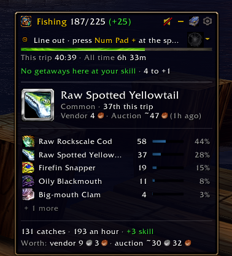
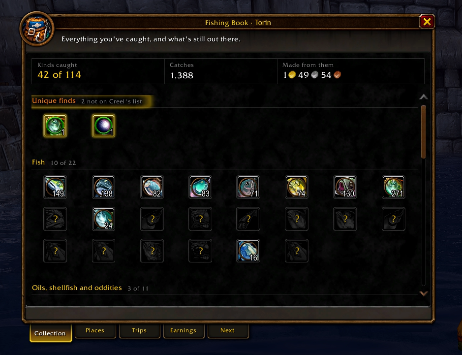

# Creel

A fishing log and one-key cast for World of Warcraft: Forever. A small
panel shows each catch and what it's worth, and a book keeps everything
you've caught and where.

**What's in it**

- **One key to cast and reel**, or double right-click to cast.
- **Panel:** your skill, a line timer, trip time, and a card for each
  catch with its vendor and auction value and a short tip.
- **Collection:** every fish and catch, with silhouettes for the ones you
  haven't found yet.
- **Recipe cards:** what a catch turns into and what the parts cost, with
  a link to Gold Wise's crafting tree if you have it.
- **Places:** your fishing spots grouped by area, with optional world map
  pins.
- **Trips and Earnings:** each trip's catches, time and worth, and what
  your catches have sold for.
- **Next:** your next rank, the nearest trainer, and where to fish at
  your skill.
- **Quiet mode:** turns off music and ambience while you fish, and puts
  your sound settings back after.
- **Lure slot:** shows your lure's time left; click it to put on the best
  one in your bags.
- **Unique finds:** anything Creel doesn't know gets its own section, and
  a short report you can send us.

**Download**

[CurseForge](https://www.curseforge.com/wow/addons/creel) (waiting for
approval there), [Wago](https://addons.wago.io/addons/creel), or the zip
from [Releases](https://github.com/flightpathlabs/Creel/releases/latest),
unpacked into `World of Warcraft\_forever_\Interface\AddOns`.

**Getting started**

Setup opens the first time you log in: pick a cast key or double-click,
and when the panel shows. Nothing is bound until you finish it. After
that, `/creel` shows the panel, `/creel book` opens the book and
`/creel options` the settings, or use the minimap button.

**Notes**

- Every cast and reel is your own key press or click. The key goes back
  to normal in combat, and your saved key bindings aren't changed.
- Auction prices come from Gold Wise if you have it, otherwise
  Auctionator. Creel doesn't scan the auction house or send anything
  anywhere.
- If another fishing addon also casts on a key, let only one of them do
  the casting.
- Trainer and vendor spots on the Next page are approximate.
- Found a bug? Open an issue on
  [GitHub](https://github.com/flightpathlabs/Creel/issues).

Item, recipe and fishing data comes from the game's own tables, read
through wago.tools. Tips are our own. Creel is a fan-made addon, not
affiliated with Blizzard Entertainment.

MIT licence, see [LICENSE](LICENSE). Changes are in the
[changelog](CHANGELOG.md). AI tooling is used openly in making this
addon; everything is reviewed and tested in game before release.

**More from Flight Path Labs**

Small addons for World of Warcraft: Forever, all at
[github.com/flightpathlabs](https://github.com/flightpathlabs).

- [Gold Wise](https://github.com/flightpathlabs/GoldWise): auction prices for what you carry, and what's worth doing with it.
- [Temper](https://github.com/flightpathlabs/Temper): how your character fights, and whether a change helped. Coming soon.
- [Encore](https://github.com/flightpathlabs/Encore): helpers for enchanters. Coming soon.
